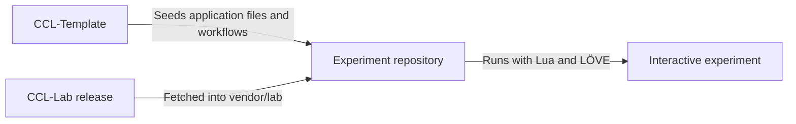

# CCL-Lab

The shared runtime and toolkit for Creative Coding Lab, built with Lua and LÖVE.

Creative Coding Lab combines a reusable platform with interactive experiments in simulation, visualisation, physics, mathematics, and computation. CCL-Lab is the shared foundation for those experiments.

## Planned capabilities

- Simulation timing, playback, stepping, and reset.
- Drawing, camera controls, spatial queries, and contact detection.
- Experiment controls, debugging, and object inspection.
- Seeded runs, configuration records, measurements, and CSV export.
- Audio controls and runtime error handling.

## How it fits together

The intended structure gives each experiment its own application and a declared Lab dependency.

Each experiment owns its model, state, and behaviour. Lab handles shared runtime and presentation services. Template supplies the starting files and development workflows.

## Development status

The repository is in its initial setup phase. Follow implementation progress in the [Creative Coding Lab project](https://github.com/users/Broomfields/projects/5).

Setup instructions and runnable examples will be added as the runtime develops.

## Documentation

- [Project introduction](https://github.com/Broomfields/CCL-Docs/blob/main/getting-started.md)
- [Developer architecture](https://github.com/Broomfields/CCL-Docs/blob/main/developer-architecture.md)
- [Coding standards](https://github.com/Broomfields/CCL-Docs/blob/main/coding-standards.md)
- [Experiment template](https://github.com/Broomfields/CCL-Template)

## Help and feedback

Use [Issues](https://github.com/Broomfields/CCL-Lab/issues) to report bugs and propose improvements. Use [Discussions](https://github.com/Broomfields/CCL-Lab/discussions) for questions and experiment ideas.

For a bug report, include the steps to reproduce it, the expected result, and your operating system and relevant tool versions.

## Credits

CCL-Lab builds on the shoulders of giants:

- [Lua](https://www.lua.org/): The programming language used throughout the project.
- [LÖVE](https://love2d.org/): The framework for graphics, audio, input, and application execution.
- [Busted](https://lunarmodules.github.io/busted/): The testing framework for Lua code.

## Licence

[MIT](https://github.com/Broomfields/CCL-Lab/blob/main/LICENSE)
