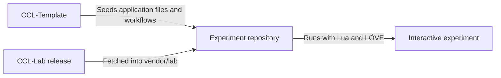

# CCL-Lab

CCL-Lab is the shared runtime for **Creative Coding Lab**, a platform I'm building for my own exploration and self-learning through programming. It uses Lua and LÖVE.

I want to take ideas I find in books and online and explore them through interactive experiments. These might involve simulation, physics, mathematics, or computation. Programming and visualisation give me a way to see how those ideas behave.

The platform provides a common foundation so I can start each experiment with the runtime, controls, and tools already in place. Together, the platform and the experiments built with it form Creative Coding Lab. I'm developing it with the same care for design, testing, and maintainability that I apply in my professional work.

You're welcome to explore the code, run the experiments, or use the platform for your own projects. The documentation records my decisions and findings, with practical instructions added as each part becomes usable.

## Development status

The repository is in its initial setup phase. The capabilities below are planned. I track progress in the [Creative Coding Lab project](https://github.com/users/Broomfields/projects/5).

Setup instructions and runnable examples will be added as the runtime develops.

## Planned capabilities

- Simulation timing, playback, stepping, and reset.
- Drawing, camera controls, spatial queries, and contact detection.
- Experiment controls, debugging, and object inspection.
- Seeded runs, configuration records, measurements, and CSV export.
- Audio controls and runtime error handling.

## How it fits together

The intended structure gives each experiment its own application and a declared Lab dependency.

Each experiment owns its model, state, and behaviour. Lab handles shared runtime and presentation services. Template supplies the starting files and development workflows.

The planned setup fetches the Lab version declared in `experiment.toml` into `vendor/lab`. [CCL-Template](https://github.com/Broomfields/CCL-Template) is being developed as the starting point for creating an experiment.

## Documentation

- [Project introduction](https://github.com/Broomfields/CCL-Docs/blob/main/getting-started.md)
- [Developer architecture](https://github.com/Broomfields/CCL-Docs/blob/main/developer-architecture.md)
- [Coding standards](https://github.com/Broomfields/CCL-Docs/blob/main/coding-standards.md)
- [Experiment template](https://github.com/Broomfields/CCL-Template)

## Help and feedback

Questions, ideas, and projects you've made are welcome in [Lab Discussions](https://github.com/Broomfields/CCL-Lab/discussions).

Use [Lab Issues](https://github.com/Broomfields/CCL-Lab/issues) for runtime bugs and improvements, and [Template Issues](https://github.com/Broomfields/CCL-Template/issues) for starter files, setup tools, and workflows.

For a bug report, include the steps to reproduce it, the expected result, and your operating system and relevant tool versions.

## Credits

The project's chosen language, framework, and testing tools are maintained by these projects and their contributors:

- [Lua](https://www.lua.org/): The programming language used throughout the project.
- [LÖVE](https://love2d.org/): The framework for graphics, audio, input, and application execution.
- [Busted](https://lunarmodules.github.io/busted/): The testing framework for Lua code.

## Licence

[MIT](https://github.com/Broomfields/CCL-Lab/blob/main/LICENSE)
